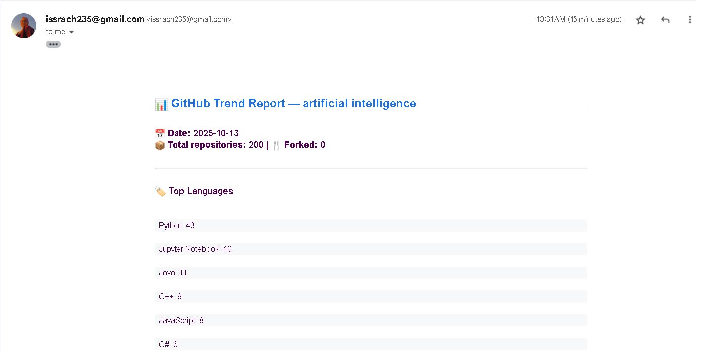
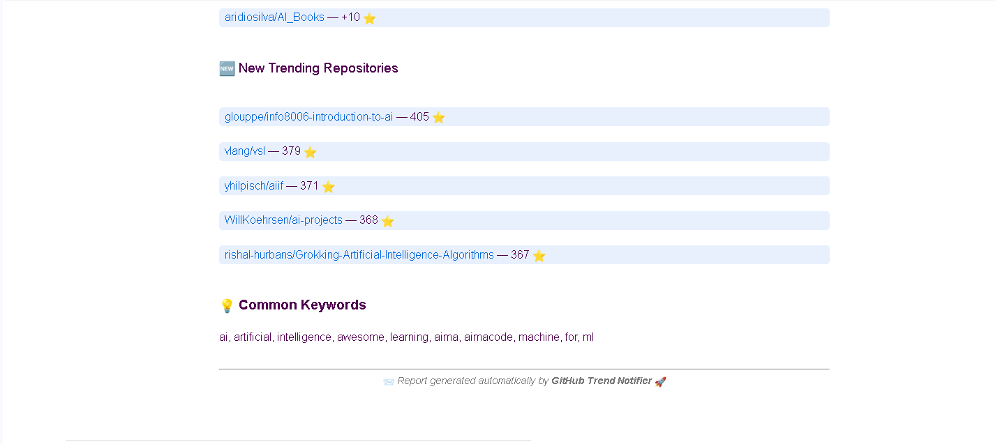

# 🤖 GitHub Trends Email Notifier
[](https://github.com/Israaelhouch/github-trends-reporter/actions)


Automatically fetch, analyze, and email the latest GitHub trending repositories—daily or on-demand—with historical data stored in a Dockerized PostgreSQL database.

---

## 🚀 Overview
**GitHub Trends Reporter** is a robust, containerized data pipeline that runs entirely within Docker Compose, simplifying setup and deployment. The pipeline:

- Fetches trending repositories from the GitHub API.
- Stores historical trend data in a dedicated PostgreSQL container.
- Analyzes top languages, organizations, and topics (comparing current vs. historical data).
- Generates structured JSON and sends formatted email reports automatically.
- Runs daily via GitHub Actions or manually via simple make commands.

---

 ## 🚀 Features
- 🔍 Fetches top trending repositories with configurable topic and top_n
- 🗄️ Stores trend history in PostgreSQL for tracking changes over time
- 📊 Processes trends and generates analysis (current vs previous data)
- ✉️ Sends weekly HTML email reports using secure credentials from GitHub Secrets
- ⏰ Fully automated GitHub Actions workflow
- 🛠️ Flexible CLI options for manual or dynamic runs

---

## ⚙️ Project Architecture & Workflow
The entire system is orchestrated by Docker Compose, ensuring that the application (app) and the database (db) run in a cohesive, isolated environment.
1. **Automation**: The pipeline is scheduled to run daily via GitHub Actions.
2. **Environment**: Secrets (tokens, emails) are passed securely into the running container via GitHub Secrets.
3. **Process**: The app container executes the main.py pipeline, connecting to the db container using the internal hostname db.
4. **Logging**: All container output is streamed to standard logs, accessible via docker compose logs.

Here’s an example of the automated weekly email summary generated by the pipeline:

<p align="center">
  
</p>
<p align="center">
  
</p>
> _These emails are automatically generated by the GitHub Actions workflow every week._

---

## 🧰 Tech Stack
- Runtime: Python (requests, pandas, SQLAlchemy, smtplib)
- Database: PostgreSQL (Containerized via Docker Compose)
- Orchestration: Docker & Docker Compose
- Automation: GitHub Actions (CI/CD scheduling)
- API: GitHub REST API

---

## ▶️ Getting Started (Local Development)
Prerequisites
You must have Docker and Docker Compose installed on your system.

### 1. Clone and Configure
- Clone the repository:
```bash
git clone https://github.com/Israaelhouch/github-trends-reporter.git
cd github-trends-notifier
```
- Create a local .env file in the root directory to securely provide credentials. These variables will be loaded by Docker Compose.
```bash
# .env
# --- Required Credentials ---
GITHUB_TOKEN=YOUR_PERSONAL_GITHUB_TOKEN
EMAIL_USER=your_sender_email@gmail.com
EMAIL_PASS=YOUR_EMAIL_APP_PASSWORD_HERE
EMAIL_TO=recipient@example.com
```
#### ⚠️ Note: For EMAIL_PASS, you must use an App Password generated by your email provider (e.g., Google) for security and access reasons.

### 2. Run the Pipeline (using Makefile)
Use the provided Makefile to easily manage the entire Docker environment.
- To run the pipeline once:
```bash
make up
```
- To view the output:
```bash
make logs
```

---

## ☁️ Automation with GitHub Actions
The pipeline is set to run automatically every day at 00:00 UTC using the provided GitHub Actions workflow.

To enable this automation in your repository, you only need to provide the necessary credentials as GitHub Secrets.
**Required Secrets Setup** :
- Go to your repository Settings $\rightarrow$ Secrets and variables $\rightarrow$ Actions.
- Add the following four secrets:
    - GITHUB_TOKEN 
    - EMAIL_USER 
    -	EMAIL_PASS 
    -  EMAIL_TO

---

## 🗂️ File Structure
```
├── .github/
│   └── workflows/
│       └── ⚙️ github_trends.yml  # GitHub Actions Daily Workflow
├── assets/
│   └── 🖼️ email_summary_*.png
├── data/
├── outputs/ 🚫 (ignored by Git)
├── src/
│   ├── db/
│   │   ├── 🐍 models.py
│   │   └── 🐍 repo_db.py         # Database connection logic
│   ├── fetcher/
│   ├── notifier/
│   ├── processor/
│   └── utils/
├── ⚙️ .gitignore
├── 🐳 Dockerfile
├── 📝 README.md
├── 🐍 config.py                  # Environment-loaded settings
├── ⚙️ docker-compose.yml         # Defines app and db services
├── 🐍 main.py                    # Pipeline entry point
├── 📄 requirements.txt
└── ⚙️ Makefile                   # Local automation commands (make up, make clean)
```

---

## 🔮 Future Improvements
- Implement proper unit and integration tests.
- Add advanced visualization (e.g., Matplotlib charts) to the email summary.
- Support multiple concurrent GitHub topics.

---

## 🙌 Credits
**Created by:** Israa Elhouch  
📧 **Contact:** israa.elhouch.dev@gmail.com 
🌐 **GitHub:** [github.com/Israaelhouch](https://github.com/Israaelhouch)

---

## ⭐ Contributing & Support

If you like this project, consider giving it a ⭐ on GitHub!
Contributions and improvements are always welcome 😊
